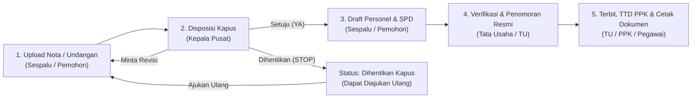

# e-SPD & ST Online — Pusdiklat Kementerian Luar Negeri RI

Sistem informasi pengelolaan **Surat Tugas (ST)** dan **Surat Perjalanan Dinas (SPD)** terintegrasi berbasis web untuk **Pusat Pendidikan dan Pelatihan (Pusdiklat) Kementerian Luar Negeri RI**. Sistem ini mendigitalisasi alur pengajuan nota/undangan dinas, disposisi pimpinan, penyusunan draft personel & rincian SPD, penomoran resmi Tata Usaha (TU), pengesahan Pejabat Pembuat Komitmen (PPK), hingga pencetakan dokumen resmi dan rekapitulasi laporan perjalanan dinas.

---

## Tech Stack

- **Backend**: PHP 8.3, Laravel 13 (`laravel/framework`)
- **Frontend**: React 18, Inertia.js v2 (`@inertiajs/react`), Tailwind CSS, Headless UI, Lucide Icons
- **Bundler**: Vite 8
- **Database**: MySQL / MariaDB (Production & Local Development), SQLite In-Memory (Automated Testing)
- **Testing & Code Quality**: PHPUnit 12, Laravel Pint

---

## Aktor & Hak Akses (Role-Based Access Control)

Sistem menerapkan pembagian peran (*role*) berlapis pada level *route middleware*, *controller*, dan *domain service*:

| Role | Kode Role | Tanggung Jawab & Hak Akses Utama |
| :--- | :--- | :--- |
| **Administrator Master** | `admin` | Mengelola seluruh Master Database (Data Pegawai, Akun Pengguna, Tingkat Biaya & Jenis Angkutan), memantau seluruh dokumen, mengakses rekapitulasi, dan menghapus histori dokumen. |
| **Pemohon / Sespalu** | `pemohon` / `sespalu` | Mengajukan Nota/Undangan Masuk (Tahap 1), menyusun Draft Personel & Rincian SPD setelah disetujui Kapus (Tahap 3), merevisi usulan, atau mengajukan ulang surat yang dihentikan. |
| **Kepala Pusat (Kapus)** | `kapus` | Meninjau nota/undangan masuk dan memberikan keputusan disposisi (**Setuju / YA**, **Revisi**, atau **Hentikan / STOP**) beserta catatan instruksi (Tahap 2), serta mengakses modul Rekapitulasi. |
| **Tata Usaha (TU)** | `tu` | Memverifikasi draft ST & SPD dari Sespalu, memberikan **Nomor Resmi ST**, **Nomor SPD**, dan **Tanggal Surat** dengan panduan nomor urut terakhir, serta menerbitkan dokumen (Tahap 4). |
| **Pejabat Pembuat Komitmen (PPK)** | `ppk` | Menyematkan persetujuan / tanda tangan digital PPK pada dokumen SPD serta memantau dokumen perjalanan dinas dan rekapitulasi. |
| **Pegawai Pelaksana** | `pegawai` | Memantau status perjalanan dinas yang menugaskan dirinya melalui Dashboard khusus Pegawai, mengunduh/mencetak dokumen ST & SPD miliknya sendiri (*row-level isolation*), serta melihat direktori pegawai (*read-only*). |

---

## Alur Kerja (Workflow 5 Tahap)



### Status Dokumen (`SuratTugasStatus`)
1. `DRAFT` — Tersimpan sebagai draft awal oleh Pemohon/Sespalu.
2. `MENUNGGU_DISPOSISI_KAPUS` — Nota/undangan telah dikirim ke Kapus dan menunggu keputusan.
3. `DISPOSISI_KAPUS_YA` — Disetujui Kapus; menunggu Sespalu melengkapi personel ditugaskan, PPK, tempat, jadwal, tingkat biaya, dan angkutan pada Tahap 3.
4. `DISPOSISI_KAPUS_REVISI` — Kapus meminta perbaikan nota/undangan kepada Sespalu.
5. `DISPOSISI_KAPUS_STOP` — Proses dihentikan oleh Kapus (dilengkapi fitur **Ajukan Ulang & Perbaiki Draft** agar tidak menjadi *dead-end*).
6. `MENUNGGU_PENOMORAN_TU` — Draft ST & SPD telah lengkap dan menunggu verifikasi serta penomoran resmi oleh petugas TU.
7. `SELESAI_TERBIT` — Nomor ST, Nomor SPD, dan Tanggal Surat telah diterbitkan oleh TU; dokumen siap diunduh/dicetak dan disahkan PPK.

---

## Progres Pengembangan Saat Ini (Status: Selesai & Teruji)

Berikut adalah daftar modul dan peningkatan arsitektur yang **telah selesai dikerjakan dan diverifikasi**:

### 1. Siklus Penuh Pengajuan & Workflow 5 Tahap
- [x] **Tahap 1 (Registrasi Nota/Undangan)**: Mendukung kategori perjalanan **Dalam Negeri** dan **Luar Negeri** (dilengkapi syarat Nomor & File Izin Setneg untuk perjalanan Luar Negeri), penyimpanan draft bertahap, serta pratinjau file lampiran PDF/Gambar/DOCX.
- [x] **Tahap 2 (Disposisi Kapus)**: Form keputusan Kapus (`YA`, `REVISI`, `STOP`) beserta sub-draft catatan Kapus.
- [x] **Tahap 3 (Draft Personel & Rincian SPD)**: Pemilihan PPK dari akun pengguna ber-role `ppk`, multi-pilihan pegawai pelaksana, tingkat biaya, jenis angkutan, kalkulasi durasi otomatis, serta opsi jadwal sama atau jadwal per pegawai.
- [x] **Tahap 4 (Penomoran Resmi TU)**: Validasi keunikan `nomor_st` dan `nomor_spd`, rujukan nomor terakhir yang terbit (*running number guide*), dan penerbitan surat.
- [x] **Tahap 5 (TTD PPK & Pencetakan Multi-Dokumen)**: Pengesahan PPK (`is_ppk_signed` & `signed_at`) serta pencetakan dokumen resmi ukuran A4.
- [x] **Pemulihan Surat Dihentikan (`DISPOSISI_KAPUS_STOP`)**: Tombol *Ajukan Ulang & Perbaiki Draft* bagi Pemohon/Sespalu/Admin untuk mengembalikan surat yang dihentikan ke mode draft tanpa kehilangan histori log.

### 2. Pemisahan Modular Dokumen Cetak (`resources/js/Pages/SuratTugas/Documents/`)
UI cetakan surat telah direfaktor menjadi komponen-komponen terpisah agar mudah dikelola dan disesuaikan tata letaknya:
- [x] [`SuratTugasDoc.jsx`](resources/js/Pages/SuratTugas/Documents/SuratTugasDoc.jsx) — Dokumen Surat Tugas (ST) resmi dengan kop surat Kementerian Luar Negeri.
- [x] [`LampiranStDoc.jsx`](resources/js/Pages/SuratTugas/Documents/LampiranStDoc.jsx) — Lampiran daftar personel Surat Tugas (otomatis digunakan apabila jumlah personel > 2 orang).
- [x] [`SpdDepanDoc.jsx`](resources/js/Pages/SuratTugas/Documents/SpdDepanDoc.jsx) — Lembar ke-1 Surat Perjalanan Dinas (SPD) per pegawai.
- [x] [`SpdBelakangDoc.jsx`](resources/js/Pages/SuratTugas/Documents/SpdBelakangDoc.jsx) — Lembar ke-2 (Visum / Rampungan I–VI) SPD per pegawai.
- [x] [`DocumentToolbar.jsx`](resources/js/Pages/SuratTugas/Documents/DocumentToolbar.jsx) — Navigasi tab antar dokumen (`Semua Dokumen`, `Surat Tugas`, `Lampiran ST`, `SPD Depan`, `SPD Belakang / Rampungan`) dan tombol cetak langsung.

### 3. Proteksi Arsip Surat (*Immutable Snapshot Locking*)
- [x] **Snapshot Pegawai Pelaksana (`surat_tugas_pegawai`)**: Nama, NIP, pangkat, golongan, jabatan, dan unit kerja pegawai dikunci saat surat dibuat.
- [x] **Snapshot Pejabat Penandatangan (`kapus_nama_snapshot`, `kapus_nip_snapshot`, `ppk_nama_snapshot`, `ppk_nip_snapshot`)**: Dikunci otomatis saat Kapus menyetujui disposisi, saat draft dikirim ke TU (`MENUNGGU_PENOMORAN_TU`), dan saat diterbitkan (`SELESAI_TERBIT`).
- [x] **Isolasi Perubahan Master Data**: Jika di kemudian hari terjadi pergantian Kepala Pusat, pergantian PPK, atau kenaikan pangkat/jabatan pegawai di Master Database, **surat yang sudah siap cetak (`MENUNGGU_PENOMORAN_TU`) maupun yang sudah terbit (`SELESAI_TERBIT`) tidak akan berubah datanya** (tetap menjaga keaslian arsip historis).

### 4. Portal & Aktor Pegawai (`role: pegawai`)
- [x] Dashboard dan daftar perjalanan dinas terisolasi (*row-level scoping* via `SuratTugas::scopeDiikutiPegawai`) sehingga pegawai **hanya** dapat melihat dan mengunduh dokumen perjalanan dinas yang menugaskan dirinya.
- [x] Direktori Pegawai *read-only* (`/pegawai`) khusus untuk role `pegawai`.

### 5. Rekapitulasi & Ekspor Laporan (`/rekapitulasi`)
- [x] Filter laporan berdasarkan Tahun, Bulan, Kategori Perjalanan (`DALAM_NEGERI` / `LUAR_NEGERI`), Status Dokumen, dan kata kunci pencarian.
- [x] Kartu ringkasan statistik perjalanan dinas dan tabel rekapitulasi terperinci.
- [x] **Ekspor ke CSV** (dengan UTF-8 BOM), **Excel (`.xls`)**, dan **Cetak / Simpan PDF** siap tanda tangan.

### 6. Keamanan, Notifikasi In-App, Audit Trail & Pemeliharaan Storage
- [x] **Penutupan Registrasi Publik**: Endpoint `/register` dinonaktifkan; pembuatan akun pengguna sepenuhnya dikendalikan oleh Admin melalui modul **Akun Pengguna** yang terhubung ke **Master Pegawai** (`pegawai_id`).
- [x] **Notifikasi In-App (Badge Lonceng & Sidebar)**: Menampilkan jumlah dan daftar surat yang membutuhkan tindak lanjut sesuai role pengguna yang sedang login (`MENUNGGU_DISPOSISI_KAPUS` untuk Kapus, `DISPOSISI_KAPUS_YA`/`REVISI` untuk Sespalu, `MENUNGGU_PENOMORAN_TU` untuk TU, dan surat belum TTD untuk PPK).
- [x] **Audit Trail (`surat_tugas_logs`)**: Mencatat setiap perubahan status, aktor pelaksana, waktu kejadian, dan catatan aksi pada panel riwayat di halaman detail surat.
- [x] **Pembersihan File Lampiran Usang (`php artisan lampiran:bersihkan`)**: Command Artisan terjadwal (dengan opsi `--dry-run`) untuk membersihkan file undangan/izin Setneg yatim (*orphan files*) di storage yang tidak lagi dirujuk oleh data aktif maupun *soft-deleted*.
- [x] **Penyederhanaan Master Database**: Tabel terpisah `ppk` telah dihapus dan diintegrasikan langsung ke akun `users` ber-role `ppk`; menu *Unit Kerja* disembunyikan dari navigasi utama untuk menjaga antarmuka tetap ringkas.

---

## Struktur Direktori Utama

```text
├── app/
│   ├── Console/Commands/
│   │   └── BersihkanLampiranUsangCommand.php  # CLI pembersih file lampiran yatim
│   ├── Http/
│   │   ├── Controllers/
│   │   │   ├── Admin/                         # CRUD Pegawai, User, Referensi Biaya & Angkutan
│   │   │   ├── DashboardController.php        # Statistik & tabel aksi cepat per role
│   │   │   ├── PegawaiDirectoryController.php # Direktori pegawai (read-only untuk role pegawai)
│   │   │   ├── RekapitulasiController.php     # Laporan & export CSV / Excel / PDF
│   │   │   └── SuratTugasController.php       # Controller utama siklus ST & SPD
│   │   └── Requests/SuratTugas/               # FormRequest validasi tiap tahapan
│   ├── Models/
│   │   ├── Pegawai.php
│   │   ├── SuratTugas.php
│   │   ├── SuratTugasLog.php
│   │   ├── SuratTugasPegawai.php
│   │   └── User.php
│   └── Services/SuratTugas/
│       ├── AttachmentService.php              # Upload, pratinjau & rollback file lampiran
│       ├── AuditLogger.php                    # Pencatatan histori workflow
│       ├── DraftService.php                   # Penyimpanan & pembacaan draft usulan
│       ├── PegawaiSnapshotService.php         # Penguncian snapshot personel ditugaskan
│       ├── SubmissionService.php              # Pengiriman Tahap 1 (ke Kapus) & Tahap 3 (ke TU)
│       ├── SuratTugasQueryService.php         # Query filter & isolasi akses per role
│       └── WorkflowService.php                # Logika Disposisi Kapus, Penomoran TU, TTD PPK & Snapshot Pejabat
└── resources/js/
    ├── Layouts/AdminLayout.jsx                # Layout utama, Sidebar & Lonceng Notifikasi In-App
    └── Pages/
        ├── Admin/                             # Halaman Master Pegawai, User, Referensi
        ├── Pegawai/Index.jsx                  # Direktori Pegawai (role pegawai)
        ├── Rekapitulasi/Index.jsx             # Modul Rekapitulasi & Export Laporan
        └── SuratTugas/
            ├── Create.jsx                     # Formulir 5-Tahap Terintegrasi
            ├── Index.jsx                      # Daftar & filter dokumen ST & SPD
            ├── Show.jsx                       # Ruang kerja detail, disposisi, penomoran, TTD & log
            ├── Print.jsx                      # Halaman pratinjau cetak A4
            └── Documents/                     # Komponen modular ST, Lampiran ST, SPD Depan & Belakang
```

---

## Panduan Instalasi & Menjalankan Sistem

### 1. Prasyarat
- PHP >= 8.3 (dengan ekstensi `pdo_mysql`, `pdo_sqlite`, `mbstring`, `fileinfo`)
- Composer
- Node.js >= 18 & NPM
- MySQL / MariaDB (mis. melalui Laragon)

### 2. Instalasi
```bash
# 1. Install dependensi PHP
composer install

# 2. Install dependensi JavaScript
npm install

# 3. Salin konfigurasi environment & generate app key
cp .env.example .env
php artisan key:generate

# 4. Jalankan migrasi database & seeder data awal
php artisan migrate --seed
php artisan db:seed --class=MasterDataSeeder

# 5. Buat symbolic link storage untuk akses lampiran
php artisan storage:link
```

### 3. Menjalankan Server Development
```bash
# Terminal 1: Jalankan server Laravel
php artisan serve

# Terminal 2: Jalankan Vite dev server (Hot Module Replacement)
npm run build   # atau: npm run dev
```

---

## Akun Demo Default (`MasterDataSeeder`)

Seluruh akun di bawah ini menggunakan kata sandi default: **`password`**

| Peran (Role) | Email Login |
| :--- | :--- |
| **Admin Master** | `admin@pusdiklat.kemlu.go.id` |
| **Sespalu / Pemohon** | `pemohon@pusdiklat.kemlu.go.id` |
| **Kepala Pusat (Kapus)** | `kapus@pusdiklat.kemlu.go.id` |
| **Tata Usaha (TU)** | `tu@pusdiklat.kemlu.go.id` |
| **Pejabat Pembuat Komitmen (PPK)** | `ppk@pusdiklat.kemlu.go.id` |

*(Akun untuk role **Pegawai** dapat ditambahkan kapan saja oleh Admin melalui menu **Master Database → Akun Pengguna** dengan memilih dari data pegawai yang terdaftar).*

---

## Pengujian & Pemeliharaan

```bash
# Menjalankan seluruh automated test (PHPUnit)
php artisan test --compact

# Memformat kode PHP sesuai standar proyek (Laravel Pint)
vendor/bin/pint

# Simulasi pembersihan file lampiran yatim (tanpa menghapus file)
php artisan lampiran:bersihkan --dry-run

# Eksekusi pembersihan file lampiran yatim
php artisan lampiran:bersihkan
```

```bash
# Menjalankan seluruh automated test (PHPUnit)
php artisan test --compact

# Memformat kode PHP sesuai standar proyek (Laravel Pint)
vendor/bin/pint

# Simulasi pembersihan file lampiran yatim (tanpa menghapus file)
php artisan lampiran:bersihkan --dry-run

# Eksekusi pembersihan file lampiran yatim
php artisan lampiran:bersihkan
```

