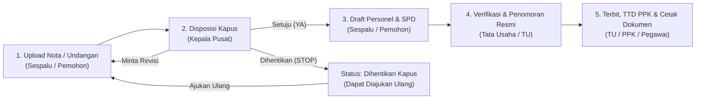

# e-SPD & ST Online — Pusdiklat Kementerian Luar Negeri RI

Sistem informasi pengelolaan **Surat Tugas (ST)** dan **Surat Perjalanan Dinas (SPD)** terintegrasi berbasis web untuk **Pusat Pendidikan dan Pelatihan (Pusdiklat) Kementerian Luar Negeri RI**. Sistem ini mendigitalisasi alur pengajuan nota/undangan dinas, disposisi pimpinan, penyusunan draft personel & rincian SPD, penomoran resmi Tata Usaha (TU), pengesahan Pejabat Pembuat Komitmen (PPK), hingga pencetakan dokumen resmi dan rekapitulasi laporan perjalanan dinas.

> **Catatan Akses**: Sistem ini bersifat **internal & tertutup**. Pendaftaran publik dinonaktifkan sepenuhnya dan seluruh akses pengguna dikelola secara terpusat oleh Administrator internal.

---

## Teknologi yang Digunakan (Tech Stack)

- **Backend Framework**: PHP 8.3 & Laravel 13
- **Frontend & UI**: React 18, Inertia.js v2 (Single Page Application), Tailwind CSS, Headless UI, Lucide Icons
- **Asset Bundler**: Vite 8
- **Database**: MySQL / MariaDB
- **Quality Assurance & Testing**: PHPUnit 12 & Laravel Pint

---

## Peran Aktor dalam Sistem (Role-Based Access Control)

| Aktor | Deskripsi & Cakupan Fitur |
| :--- | :--- |
| **Administrator Master** | Mengelola seluruh Master Database (Data Pegawai, Akun Pengguna, Tingkat Biaya & Jenis Angkutan), memantau seluruh dokumen perjalanan dinas, serta mengakses modul rekapitulasi. |
| **Pemohon / Sespalu** | Mengajukan Nota/Undangan Masuk (Tahap 1), menyusun Draft Personel & Rincian SPD setelah disetujui Kapus (Tahap 3), merevisi usulan, atau mengajukan ulang surat yang dihentikan. |
| **Kepala Pusat (Kapus)** | Meninjau nota/undangan masuk dan memberikan keputusan disposisi (**Setuju**, **Minta Revisi**, atau **Hentikan**) beserta catatan instruksi (Tahap 2), serta memantau rekapitulasi laporan. |
| **Tata Usaha (TU)** | Memverifikasi kelengkapan draft ST & SPD dari Sespalu, menetapkan **Nomor Resmi ST**, **Nomor SPD**, dan **Tanggal Surat**, serta menerbitkan dokumen resmi (Tahap 4). |
| **Pejabat Pembuat Komitmen (PPK)** | Menyematkan pengesahan / tanda tangan digital PPK pada dokumen SPD serta memantau dokumen perjalanan dinas dan rekapitulasi. |
| **Pegawai Pelaksana** | Memantau status perjalanan dinas yang menugaskan dirinya melalui Dashboard Pegawai, mengunduh/mencetak dokumen ST & SPD miliknya sendiri, serta melihat direktori pegawai (*read-only*). |

---

## Alur Kerja Sistem (Workflow 5 Tahap)

---

## Fitur Utama & Progres Pengembangan (Status: Selesai)

### 1. Pengajuan & Alur Persetujuan 5 Tahap Terintegrasi
- [x] **Tahap 1 — Registrasi Nota / Undangan Masuk**: Mendukung kategori perjalanan **Dalam Negeri** maupun **Luar Negeri** (dilengkapi validasi Nomor & Berkas Izin Setneg untuk perjalanan Luar Negeri), penyimpanan draft bertahap, serta pratinjau dokumen lampiran (PDF, Gambar, DOCX).
- [x] **Tahap 2 — Disposisi Kepala Pusat**: Mendukung keputusan **Setuju**, **Minta Revisi**, dan **Hentikan (Stop)** beserta catatan disposisi dan fitur penyimpanan sub-draft.
- [x] **Tahap 3 — Penyusunan Personel & Rincian SPD**: Pemilihan PPK, pemilihan multi-pegawai pelaksana, penentuan tingkat biaya & jenis angkutan, kalkulasi durasi perjalanan otomatis, serta dukungan mode **Jadwal Sama** maupun **Jadwal per Pegawai**.
- [x] **Tahap 4 — Verifikasi & Penomoran Resmi TU**: Dilengkapi panduan rujukan nomor urut terakhir yang terbit (*running number guide*) serta validasi anti-duplikasi nomor ST dan nomor SPD.
- [x] **Tahap 5 — Pengesahan PPK & Penerbitan Dokumen**: Pengesahan tanda tangan digital PPK dan pencetakan dokumen ukuran standar A4.
- [x] **Mekanisme Pengajuan Ulang (*Resubmission*)**: Surat yang dihentikan pada tahap disposisi dapat diajukan ulang dan diperbaiki kembali oleh Pemohon/Sespalu tanpa kehilangan catatan riwayat sebelumnya.

### 2. Pencetakan Dokumen Modular Berstandar Resmi
Modul pencetakan telah dipisahkan per jenis dokumen untuk memudahkan pemeliharaan tata letak cetak:
- [x] **Surat Tugas (ST)** lengkap dengan kop surat resmi dan blok tanda tangan Kepala Pusat.
- [x] **Lampiran Surat Tugas** otomatis aktif apabila personel yang ditugaskan lebih dari 2 pegawai.
- [x] **Lembar SPD Depan (Lembar 1)** untuk masing-masing pegawai yang ditugaskan.
- [x] **Lembar SPD Belakang / Visum & Rampungan (Lembar 2, Blok I–VI)** untuk masing-masing pegawai.
- [x] **Toolbar Pemilihan Dokumen** untuk mencetak seluruh bundel sekaligus atau memilih dokumen tertentu saja.

### 3. Penguncian Data Arsip (*Immutable Snapshot Protection*)
- [x] **Snapshot Personel Ditugaskan**: Nama, NIP, pangkat, golongan, jabatan, dan unit kerja pegawai dikunci saat surat dibuat.
- [x] **Snapshot Pejabat Penandatangan (Kapus & PPK)**: Identitas Kepala Pusat dan PPK dikunci otomatis pada saat disposisi disetujui dan saat dokumen siap cetak/terbit.
- [x] **Keaslian Arsip Historis**: Perubahan jabatan pegawai atau pergantian Kepala Pusat/PPK di database master di kemudian hari tidak akan mengubah isi surat yang sudah siap cetak maupun yang telah terbit.

### 4. Portal Khusus Pegawai & Isolasi Data
- [x] **Isolasi Perjalanan Dinas (*Row-Level Isolation*)**: Setiap pegawai hanya dapat melihat dan mengunduh dokumen perjalanan dinas yang mencantumkan dirinya sebagai pelaksana tugas.
- [x] **Direktori Pegawai (*Read-Only*)**: Menyediakan daftar informasi dasar kepegawaian tanpa akses ubah/hapus.

### 5. Modul Rekapitulasi & Ekspor Laporan
- [x] Penyaringan laporan perjalanan dinas berdasarkan tahun, bulan, kategori perjalanan, status dokumen, dan kata kunci.
- [x] Ringkasan metrik perjalanan dinas dalam bentuk kartu statistik.
- [x] Ekspor laporan ke format **CSV**, **Excel (`.xls`)**, dan **Cetak / Simpan PDF**.

### 6. Notifikasi In-App, Audit Trail & Tata Kelola Sistem
- [x] **Notifikasi *In-App* Otomatis**: Indikator lonceng notifikasi dan *badge* menu yang menampilkan daftar dokumen yang membutuhkan tindakan sesuai peran pengguna.
- [x] **Riwayat Audit (*Audit Trail*)**: Pencatatan kronologis setiap perubahan status, waktu kejadian, aktor pelaksana, dan catatan revisi/disposisi.
- [x] **Manajemen Akun Terpusat**: Pembuatan akun pengguna ditautkan langsung dari data Master Pegawai tanpa akses registrasi publik.
- [x] **Pemeliharaan Penyimpanan Otomatis**: Sistem dilengkapi utilitas pembersihan berkas lampiran usang (*orphan files*) agar ruang penyimpanan tetap efisien.
